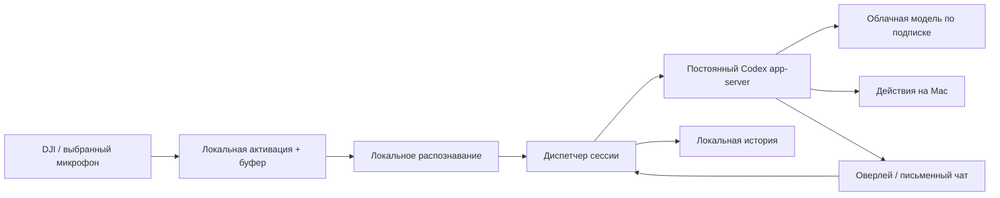

# Проектирование wchat

Дата: 2026-11-13. Статус: предложение архитектуры и план проверок. Код приложения пока не написан.

## Пользовательский сценарий

На Mac работает приложение в строке меню. Пользователь выбирает DJI Mic Mini и рабочую сессию. Пока включено прослушивание, приложение локально ждёт кодовую фразу, например «Слушай, помощник»; точная фраза будет настраиваться.

После активации открывается небольшой оверлей. В нём видны распознаваемая просьба и выбранная сессия. Когда пользователь закончил говорить, текст уходит в Codex. Ответ и ход выполнения появляются по мере поступления. Следующую реплику можно сказать или напечатать. Поручение продолжает ту же историю, пока пользователь явно не переключит диалог.

## Первый выпуск

| Возможность | Пользовательский результат |
| --- | --- |
| Выбор микрофона и локальная кодовая фраза | Можно обратиться к ассистенту без клавиатуры; при потере DJI отображается ошибка, а не тихая подмена устройства |
| Push-to-talk и письменный ввод | Можно работать при шуме, ошибке активации или отсутствии микрофона |
| Системный оверлей и строка меню | Видны текст, состояние микрофона, ход задачи и ответ; горячая клавиша показывает/скрывает окно |
| Codex через подписку ChatGPT | Авторизация через установленный Codex, без API-ключа в настройках wchat |
| Выбор и продолжение сессии | Письменная и голосовая реплики попадают в один диалог и правильную рабочую папку |
| Отмена и обработка занятой сессии | «Стоп» отменяет текущую задачу, новые сообщения не запускают конфликтующие действия |
| История и восстановление | После перезапуска видны сообщения и исход задач; незавершённая задача не обозначается успешной |
| Измерение задержки | Видно, где потеряно время: завершение речи, распознавание, сеть/модель или инструменты |

Озвучка краткого ответа по завершающему слову «звук» описана в [бэклоге](backlog.md). Она, удалённый исполнитель и телефонный клиент - следующие этапы. Основной результат первого выпуска отображается текстом. Существующие проекты `~/st/` и `~/.local/share/valentina/` можно использовать как источники опыта; перенос их кода требует отдельной проверки.

## Предлагаемая архитектура

Выбор для первого прототипа: Swift/SwiftUI + AppKit для интерфейса и аудио, локальный речевой движок и отдельный постоянный процесс Codex. Один нативный хост упрощает владение микрофоном, жизненным циклом окна и разрешениями macOS. Выделение Go-сервиса сейчас не требуется; его можно рассмотреть при появлении удалённого исполнителя.



Будущая структура, пока только проект:

```text
wchat/
  Sources/WChatApp/       окно, строка меню, настройки, горячие клавиши
  Sources/Audio/          устройство, буфер, активация, конец реплики
  Sources/Speech/         адаптер локального распознавания
  Sources/CodexBridge/    транспорт, сессии, события, отмена
  Sources/Conversation/   очередь, сообщения, состояние задачи
  Sources/Persistence/    локальная история и миграции
  Tests/                 проверки протокола, аудиофикстур и восстановления
  docs/                  разведка, решения и результаты измерений
```

### Интеграция с Codex

Предпочтительный транспорт - `codex app-server` по stdio. Инициализируем соединение один раз, затем создаём или возобновляем thread, отправляем turn и принимаем потоковые события. Официальный протокол описывает `thread/start`, `thread/resume`, `turn/start`, `item/agentMessage/delta`, `turn/completed` и `turn/interrupt`. Авторизацией управляет Codex; wchat не копирует OAuth-токены и не обращается к закрытым веб-эндпоинтам. [Протокол](https://learn.chatgpt.com/docs/app-server).

Проектные правила клиента:

- Перед первой задачей проверять тип входа. Если выбран API-key режим, сообщить о необходимости входа через ChatGPT; не переключаться на платный API незаметно.
- Сохранять соответствие локального диалога и `threadId`, рабочую папку, идентификаторы turn и сообщений.
- На одну сессию выполнять одну задачу; последующие реплики ставить в видимую очередь. Переключение сессии не меняет адресата уже принятого сообщения.
- Учитывать запросы подтверждения от Codex и возвращать ответ в соответствующий запрос, не обходя его через shell.
- Показывать реальные результаты завершения: completed, failed, interrupted. Ответный текст сам по себе не означает успешного действия.
- После обрыва сначала сверять состояние сессии. При неизвестном исходе показывать его пользователю, не повторять побочные эффекты автоматически.
- Начать с собственных сессий wchat. Продолжение уже открытой в другом клиенте сессии включать только после проверки конкурентного доступа.
- Проверить, какие плагины, инструкции и инструменты доступны дочернему app-server. Возможности текущего интерактивного клиента не считать автоматически доступными новому процессу.

### Активация и распознавание

В ожидании нужен лёгкий локальный детектор, а не постоянный запуск большого Whisper. До активации держим только короткий кольцевой буфер в памяти, чтобы не потерять начало команды. После неё записываем речь до паузы, с ограничением максимальной длительности.

Первый кандидат для русской фразы - небольшая Vosk-модель с ограниченным словарём. Vosk документирует офлайн-работу, русский язык, потоковое распознавание и настройку словаря. Это основание для эксперимента, а не доказательство точности wake word. Для отклонения посторонней речи нужны порог, неизвестное слово и испытания на отрицательных примерах. [Vosk](https://alphacephei.com/vosk/).

Альтернатива - Apple Speech, если локальное распознавание русского подтверждается на целевом устройстве. Не включать облачный fallback без явного выбора. openWakeWord не считать готовым русским решением: его README заявляет поддержку английского. [openWakeWord](https://github.com/dscripka/openWakeWord).

Для свободной русской команды первым проверяем whisper.cpp с постоянно загруженной моделью; сравниваем небольшую мультиязычную модель и уже имеющийся large-v3-turbo. Проект поддерживает ускорение на Apple Silicon, но конкретный backend установленной сборки и выигрыш необходимо измерить. [whisper.cpp](https://github.com/ggml-org/whisper.cpp).

### Как уменьшать задержку

Это гипотезы для прототипа, не обещанные результаты.

1. Держать app-server запущенным и выбранную сессию готовой. Не запускать CLI и не загружать всю историю заново для каждой реплики.
2. Загружать STT-модель один раз в режиме активной работы. После длительного простоя освобождать её по выбранному энергопрофилю.
3. Настраивать конец реплики по речи и тишине. Начать с экспериментов в диапазоне 350-700 мс, отдельно проверяя паузы внутри русской фразы. Слишком ранняя отправка портит смысл команды.
4. Показывать промежуточную транскрипцию локально; отправлять исполнимое поручение только после фиксации текста. Не запускать действия по нестабильной гипотезе распознавания.
5. Показывать текст ответа по мере прихода. Для обычного диалога выбирать доступный быстрый режим модели после замеров; для сложной задачи оставлять более вдумчивый режим. Название модели и поддержку параметров определить по установленной версии и реальным запросам.
6. Команды самого интерфейса, например «стоп», «пауза» и «покажи чат», обрабатывать локально. Они не требуют ожидания облачного ответа.
7. Ограничивать передаваемый контекст нужной сессией. Не добавлять в каждый запрос весь локальный архив.

Разделяем метрики:

```text
конец речи -> детектор конца -> финальная транскрипция -> отправка turn
отправка turn -> первый видимый текст -> завершение задачи
```

Первая продуктовая цель для короткого вопроса на прогретом приложении: медиана от конца речи до первого текста до 2,5 с, p95 до 5 с. Цели пока не подтверждены и могут оказаться недостижимыми с выбранной моделью/сетью. Время завершения инструментальных задач измеряется отдельно. Сравнение холодного и прогретого запуска обязательно; скорость простого подтверждения «принято» не подменяет скорость содержательного ответа.

### Оверлей и состояния

Нативная плавающая панель с настройкой закрепления поверх окон. Чат содержит ввод текста, потоковый ответ, выбор диалога, рабочую папку и кнопку отмены. При показе результата панель не должна перехватывать клавиатуру; фокус включается по явному открытию ввода. Поведение в полноэкранных приложениях и между Spaces проверяется отдельно.

Состояния: пауза, ожидание фразы, запись, распознавание, ожидание очереди, выполнение, запрос подтверждения, завершено, ошибка. Состояние микрофона отображается независимо от состояния задачи. При отключении DJI приложение явно показывает потерю устройства. При сне/пробуждении захват пересоздаётся без повторной отправки старой записи.

### Хранение и энергопотребление

История и настройки размещаются в Application Support, не в репозитории. Предлагается SQLite с миграциями. Аудио не сохраняется по умолчанию; диагностическая запись включается отдельно. В логах достаточно временных меток, идентификаторов и кодов ошибок.

Приложение не удерживает Mac бодрствующим по умолчанию. При паузе микрофон освобождается. Режим «всегда готов» сохраняет STT в памяти, экономичный режим допускает холодный старт. Ни один из них не обещает работу во сне или отсутствие нагрева. Для сценария с ноутбуком в рюкзаке предусмотреть отдельную будущую архитектуру «телефон -> домашний исполнитель».

## Этапы и критерии готовности

1. **Письменный чат и Codex.** Из оверлея отправить реальный запрос по подписке, получить потоковый ответ, продолжить тот же thread, отменить задачу и восстановить историю после перезапуска. Проверить реальное действие в отдельной тестовой папке и содержимое результата.
2. **Голос по кнопке.** Подключить DJI, дать русское поручение и получить тот же результат, что при вводе текста. Проверить имя проекта, числа, паузы, отсутствие речи и отключение микрофона.
3. **Кодовая фраза.** Не менее 50 положительных примеров и фоновые записи с похожими словами/музыкой. Начальная цель: не менее 95% активаций и не более одной ложной активации за 8 часов репрезентативного фона. Это тестовые цели, не текущие показатели.
4. **Надёжность и задержка.** Повторить сценарии с обрывом сети, занятым thread, лимитом подписки, крашем дочернего процесса и сном/пробуждением. Проверить отсутствие дублей и сохранность истории. Измерить p50/p95, CPU, память и расход батареи в ожидании и при поручениях.

## Что проверено в разведке

- Создан пустой Git-репозиторий в `~/wchat/`, ветка `main`.
- Система: macOS 26.6.2, arm64.
- Установлен Codex CLI 0.167.2; `codex login status` сообщает `Logged in using ChatGPT`.
- Команда `codex app-server --help` доступна, заявлен транспорт stdio.
- Отдельный процесс app-server успешно прошёл `initialize`/`initialized`, `account/read` вернул тип `chatgpt`, `model/list` вернул 8 записей. Проверка использовала чтение JSON-строк из байтового потока; первоначальный диагностический клиент с текстовой буферизацией получил тайм-аут. После проверки завершён только запущенный для неё процесс.
- Найдены `whisper-cli` и модель `~/.local/share/valentina/models/ggml-large-v3-turbo.bin` размером около 1,5 ГБ. В wchat они не копировались.

Выполнение модельного запроса, фактический лимит аккаунта, аудиозахват DJI, точность русской активации, задержка, разрешения macOS и интерфейс пока не проверены. Приложения для этого ещё нет.
